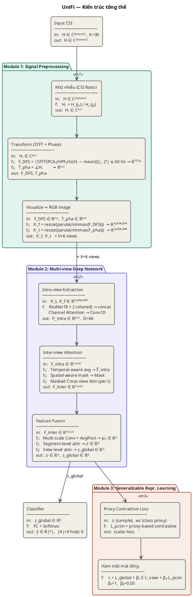
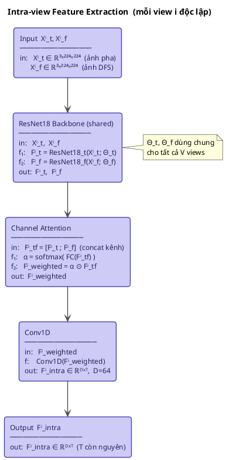
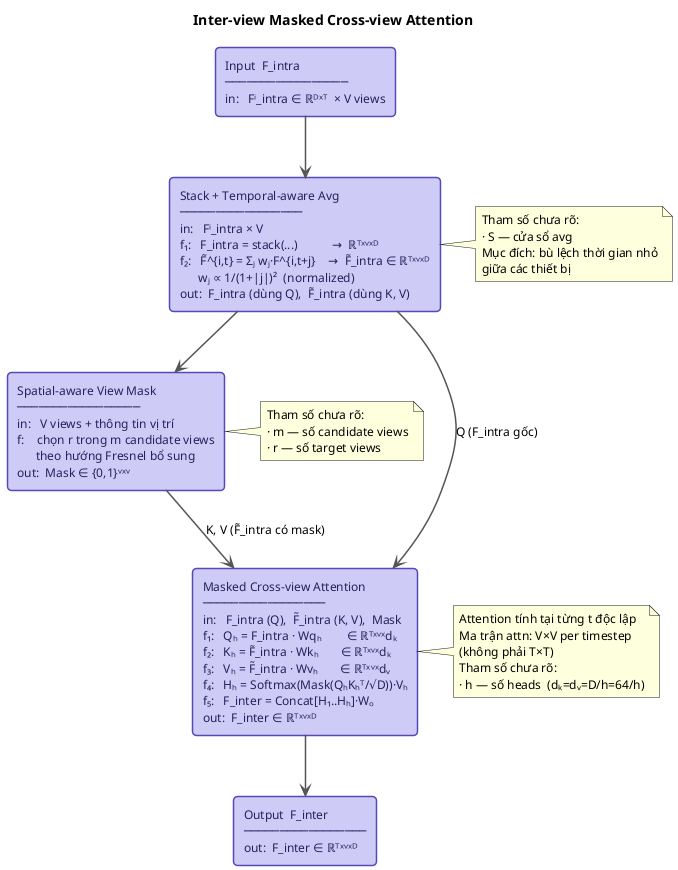
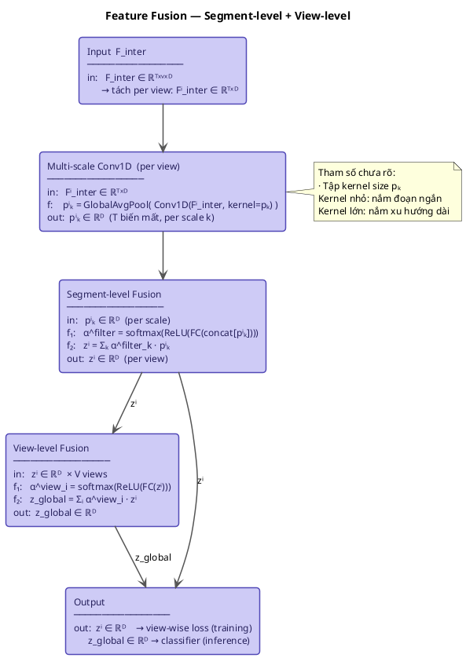

# Kiến trúc mô hình UniFi

> Liu et al., "UniFi: A Unified Framework for Generalizable Gesture Recognition with Wi-Fi Signals Using Consistency-guided Multi-View Networks." *Proc. ACM IMWUT*, vol. 7, no. 4, Article 168, December 2023. DOI: 10.1145/3631429

---

## Luồng dữ liệu tổng quát

```
Input CSI  H ∈ ℂᴹˣᴺˣᴷˣᵀ   M=1 TX, N=3 RX anten, K=30 sub-carrier
        ↓
  ┌────────────────────────────────────────────────────────┐
  │  Module 1: Signal Preprocessing                        │
  │    Khử nhiễu:  Hᵣ = H_{j₁} / H_{j₂}  ∈ ℂᴷˣᵀ         │
  │       ↓                                                │
  │    Biến đổi:   trừ mean → HPF 2 Hz → PCA → STFT        │
  │                → DFS ∈ ℝ¹²¹ˣᴸ                         │
  │                ∠Hᵣ → T_pha ∈ ℝᴷˣᵀ                    │
  │       ↓                                                │
  │    Visualize:  min-max + parula → resize 224×224       │
  │                Xⁱ_f ∈ ℝ³ˣ²²⁴ˣ²²⁴  (ảnh DFS)          │
  │                Xⁱ_t ∈ ℝ³ˣ²²⁴ˣ²²⁴  (ảnh pha)          │
  └──────────────────────── ↓ ─────────────────────────────┘
    × V=6 receivers → V bộ (Xⁱ_f, Xⁱ_t)
        ↓
  ┌────────────────────────────────────────────────────────┐
  │  Module 2: Multi-view Deep Network                     │
  │  [Intra-view]                                          │
  │    ResNet18(Xⁱ_t) + ResNet18(Xⁱ_f) → concat          │
  │    Channel Attention + Conv1D                          │
  │    → Fⁱ_intra ∈ ℝᴰˣᵀ,  D=64                          │
  │       ↓                                                │
  │  [Inter-view]                                          │
  │    Stack V views → F_intra ∈ ℝᵀˣᵛˣᴰ                   │
  │    Temporal-aware avg → F̃_intra                        │
  │    Spatial-aware mask → Mask ∈ {0,1}ᵛˣᵛ              │
  │    Masked Cross-view Attention (tại từng t)            │
  │    → F_inter ∈ ℝᵀˣᵛˣᴰ                                 │
  │       ↓                                                │
  │  [Fusion]                                              │
  │    Multi-scale Conv1D + GlobalAvgPool → pⁱₖ ∈ ℝᴰ     │
  │    Segment-level fusion → zⁱ ∈ ℝᴰ                     │
  │    View-level fusion → z_global ∈ ℝᴰ                  │
  └──────────────────────── ↓ ─────────────────────────────┘
        ↓
  ┌────────────────────────────────────────────────────────┐
  │  Module 3: Generalizable Representation Learning       │
  │    Proxy w_c = trọng số FC cuối (class proxy)          │
  │    L_pcon = proxy-based contrastive loss               │
  │    L = L_global + β₁·Σ Lⁱ_view + β₂·L_pcon           │
  │            β₁=1, β₂=0.05                              │
  └──────────────────────── ↓ ─────────────────────────────┘
        ↓
  Classifier: FC(z_global) + Softmax → ℝ|ᴬ|
  |A| = 9 (Widar room 1) hoặc 6 (room 2, 3)
```

---

## Chi tiết từng thành phần

### Module 1 — Signal Preprocessing

Code: `unifi_preprocessing.py` (biến đổi + ảnh), `main.py` (đọc `.dat`).

UniFi chỉ mô tả ngắn gọn module này và dẫn sang hai bài khác:
- **[12]** Gu et al., *Attention-Based Gesture Recognition Using Commodity WiFi Devices*, IEEE Sensors J. 2023 — ảnh pha/biên độ CSI ratio, resize 224×224×3.
- **[13]** Gu et al., *WiFE: WiFi and Vision Based Unobtrusive Emotion Recognition…* — phương pháp vẽ heatmap.

Tham số STFT không được báo cáo ở bài nào → chọn theo code gốc Widar3.0 (`DFSExtractionCode/get_doppler_spectrum.m`: fs = 1000, giữ ±60 Hz) và **kiểm tra trực quan với Fig. DFS của UniFi** (trục −60…60 Hz, 0…1.2 s, colorbar 0…1).

#### 1a. Đọc CSI + Khử nhiễu (CSI Ratio)

**Input:** 6 file `userX-<gesture>-<loc>-<ori>-<rep>-r<1..6>.dat` (Intel 5300), 1 file = 1 bộ thu = 1 view

**Đọc file** (`read_bf_file` trong `main.py`, port từ `read_bfee.c` của Linux 802.11n CSI Tool):
```
record = [2 byte độ dài big-endian][1 byte code][payload]
code 187 (0xBB) → CSI: Nrx=3, Ntx=1, 30 sub × 3 anten × (real, imag) int8
hoán vị anten theo antenna_sel
→ H ∈ ℂ¹ˣ³ˣ³⁰ˣᵀ   (T = số packet, 1000 packet/s, khác nhau giữa mẫu VÀ giữa bộ thu)
```
Không cần `get_scaled_csi`: hệ số scale giống nhau cho mọi anten trong 1 packet → triệt tiêu khi chia.

**Công thức** ([12] eq. 3 — hai anten **liền kề** cùng bộ thu, dùng j₁=1, j₂=2):
```
Hᵣ = H_{i,j₁} / H_{i,j₂}
   = [Aₙ·e^{-jθₙ}·(H_s1 + H_d1)] / [Aₙ·e^{-jθₙ}·(H_s2 + H_d2)]
   = (H_s1 + H_d1) / (H_s2 + H_d2)
```

**Output:** Hᵣ ∈ ℂᴷˣᵀ — nhiễu biên độ Aₙ và lệch pha θₙ được triệt tiêu

#### 1b. Biến đổi (Transform)

**Input:** Hᵣ ∈ ℂᴷˣᵀ,  K = 30

**f₁ — DFS** (`extract_dfs`):
```
① Bỏ thành phần tĩnh   H_d = Hᵣ − mean_t(Hᵣ)                    ∈ ℂ³⁰ˣᵀ
② Lọc thông cao        H_d ← HPF(H_d)   Butterworth bậc 3, 2 Hz, nhân quả, từng sub-carrier
                       (bật/tắt: DFS_HIGHPASS trong main.py, mặc định bật)
③ PCA                  s = H_dᵀ · v₁   (v₁ = thành phần chính 1)  ∈ ℂᵀ
④ STFT                 Hann, nperseg = 256, hop = 8, nfft = 1000, không pad
                       → 1 Hz/bin, hai phía (giữ tần số âm)
⑤ Cắt dải              |f| ≤ 60 Hz,  F_DFS = |STFT(s)|           ∈ ℝ¹²¹ˣᴸ
                       F = 121,  L = (T − 256)/8 + 1
```

| Bước | Lý do |
|---|---|
| ① trừ mean | Đường truyền tĩnh (LoS, tường) là hằng số theo thời gian → dồn ~70% năng lượng vào \|f\| ≤ 2 Hz; không trừ thì ảnh chỉ còn một vạch ngang ở 0 Hz, không thấy vệt Doppler như Fig. của UniFi. |
| ② HPF 2 Hz | Theo `get_doppler_spectrum.m` của Widar3.0 (`butter(3, 2/500, 'high')` + `filter`, áp lên từng sub-carrier trước PCA). Trừ mean chỉ bỏ DC tuyệt đối; trôi chậm của kênh vẫn để lại dải sáng ±5 Hz suốt mẫu, kể cả lúc đứng yên → min-max toàn ảnh làm dải này sáng nhất, vệt Doppler của cử chỉ (±20–60 Hz) bị tối. Lọc 2 Hz xóa dải ở đoạn tĩnh, giữ phần tần số thấp lúc đang chuyển động (so sánh: `figures/input_g*.png`, hàng 1 vs 2). Lọc nhân quả giống Widar → năng lượng trễ ~0.05–0.1 s, như nhau với mọi mẫu. Low-pass 60 Hz của Widar không cần vì bước ⑤ đã cắt \|f\| ≤ 60 Hz. |
| ③ PCA | Cử chỉ tác động tương quan lên 30 sub-carrier; PC1 giữ phần chuyển động (Widar3.0 và WiFE [13] đều dùng PC1). Ảnh gần như giống hệt trung bình \|STFT\| của 30 sub nhưng chỉ cần 1 STFT → nhanh ~30 lần. |
| ④ không pad | Giống `spectrogram` MATLAB: mất ½ cửa sổ mỗi đầu → mẫu T = 1467 (1.47 s) cho trục DFS ≈ 1.2 s, đúng như Fig. của UniFi. |
| ⑤ ±60 Hz | Theo Widar3.0 và trục của Fig. UniFi. |

**f₂ — Pha** (`extract_phase`):
```
T_pha = ∠Hᵣ ∈ [−π, π]     ∈ ℝ³⁰ˣᵀ     (không unwrap)
```
Fig. 3 của [12] có dải pha nhảy ±π (vàng lẫn đốm xanh đậm) → dùng pha gốc.

**Output:** F_DFS ∈ ℝ¹²¹ˣᴸ,   T_pha ∈ ℝ³⁰ˣᵀ

#### 1c. Visualize (Heatmap → Ảnh RGB)

**Input:** F_DFS ∈ ℝᶠˣᴸ,   T_pha ∈ ℝᴷˣᵀ

**Công thức** (`to_rgb_image` — tương đương `imagesc` của MATLAB):
```
① Chuẩn hóa      M̂ = (M − min M) / (max M − min M)      min-max trên TOÀN ảnh
② Colormap       Xⁱ = parula(M̂)  → ℝ³ˣᴴˣᵂ              (RGB, bỏ alpha)
③ Resize         bilinear + antialias → 3 × 224 × 224   (WiDarDataset)

f₁ (DFS image):  Xⁱ_f = resize(parula(minmax(F_DFS)))   →  ℝ³ˣ²²⁴ˣ²²⁴
f₂ (pha image):  Xⁱ_t = resize(parula(minmax(T_pha)))   →  ℝ³ˣ²²⁴ˣ²²⁴
```

| Bước | Căn cứ |
|---|---|
| ① min-max toàn ảnh | Heatmap trong [12], [13] và Fig. DFS của UniFi: độ sáng thay đổi theo thời gian/dải → không chuẩn hóa theo cột (khác Widar3.0) hay theo dải. |
| ② parula | Cả 3 bài ([12] Fig. 3, [13] Fig. 3–4, UniFi Fig. DFS) đều dùng parula (xanh tím → xanh lơ → vàng). Matplotlib không có sẵn → `PARULA` dựng từ 17 điểm mốc lấy mẫu trên colorbar Fig. DFS của UniFi. |
| ③ 224×224 | [12]: *"resize the dimensions of the input image to 224×224×3"*; [13]: *"unified each CSI data into a same size image"*. Bắt buộc vì T, L khác nhau giữa mẫu và giữa 6 bộ thu của cùng một mẫu → DataLoader mới stack được batch. Resize làm **một lần** ở `WiDarDataset`, intra-view nhận ảnh đã đúng kích thước. |

**Output:** Xⁱ_f ∈ ℝ³ˣ²²⁴ˣ²²⁴,   Xⁱ_t ∈ ℝ³ˣ²²⁴ˣ²²⁴   (C=3 kênh RGB),  × V=6 views

> **Tự chọn (không có trong bài):** cửa sổ Hann 256 / hop 8 (Widar dùng Gauss 251 / hop 1; đã thử Gauss 251 với hop 8 → ảnh gần như giống nhau), trừ mean + HPF 2 Hz của Widar (bỏ low-pass 60 Hz vì đã cắt dải sau STFT), PCA thay vì trung bình sub-carrier. Ảnh biên độ T_amp (DPA trong UniFi Fig. 13) chưa dùng — model hiện chỉ nhận DFS + pha (DP).

---

### Module 2 — Multi-view Deep Network

#### 2a. Intra-view Feature Extraction

**Input:** Xⁱ_t ∈ ℝ³ˣ²²⁴ˣ²²⁴,   Xⁱ_f ∈ ℝ³ˣ²²⁴ˣ²²⁴   (mỗi view i độc lập, đã resize ở Module 1)

**Công thức:**
```
f₁ (time backbone):  Fⁱ_t = ResNet18_t(Xⁱ_t; Θ_t)     shared across views
f₂ (freq backbone):  Fⁱ_f = ResNet18_f(Xⁱ_f; Θ_f)     shared across views
f₃ (concat):         Fⁱ_tf = [Fⁱ_t ; Fⁱ_f]             nối theo chiều kênh
f₄ (channel attn):   α = softmax(FC(Fⁱ_tf))
                      Fⁱ_weighted = α ⊙ Fⁱ_tf
f₅ (conv):           Fⁱ_intra = Conv1D(Fⁱ_weighted)
```

**Output:** Fⁱ_intra ∈ ℝᴰˣᵀ,   D=64

#### 2b. Inter-view: Stack + Temporal-aware Avg

**Input:** Fⁱ_intra ∈ ℝᴰˣᵀ   (V views)

**Công thức:**
```
f₁ (stack):   F_intra = stack([F¹_intra,...,Fᵛ_intra])   →  ℝᵀˣᵛˣᴰ

f₂ (temporal-aware avg):
  F̃^{i,t} = Σ_{j=−S}^{S} wⱼ · F^{i,t+j}_intra
  wⱼ ∝ 1/(1+|j|)²  (normalized)                         →  F̃_intra ∈ ℝᵀˣᵛˣᴰ
```

**Output:** F_intra ∈ ℝᵀˣᵛˣᴰ (dùng làm Q),   F̃_intra ∈ ℝᵀˣᵛˣᴰ (dùng làm K, V)

> **Tham số chưa rõ:** S — cửa sổ temporal-aware avg (không được báo cáo).

#### 2c. Inter-view: Spatial-aware Mask

**Input:** V views, thông tin vị trí thiết bị (Fresnel zone)

**Công thức:**
```
Với mỗi view i:
  1. Chọn m candidate views đặt ở hướng khác nhau (Fresnel complementary)
  2. Random chọn r target views từ m candidates
  3. Mask[i, j] = 0 nếu j không được chọn, 1 nếu được chọn
```

**Output:** Mask ∈ {0,1}ᵛˣᵛ

> **Tham số chưa rõ:** m và r — số views candidate và target (không được báo cáo).

#### 2d. Inter-view: Masked Cross-view Attention

**Input:** F_intra ∈ ℝᵀˣᵛˣᴰ (Q),   F̃_intra ∈ ℝᵀˣᵛˣᴰ (K, V),   Mask ∈ {0,1}ᵛˣᵛ

**Công thức (tính độc lập tại từng bước thời gian t):**
```
Qₕ = F_intra · Wqₕ      ∈ ℝᵀˣᵛˣdₖ
Kₕ = F̃_intra · Wkₕ     ∈ ℝᵀˣᵛˣdₖ
Vₕ = F̃_intra · Wvₕ     ∈ ℝᵀˣᵛˣdᵥ

Hₕ = Softmax( Mask(Qₕ·Kₕᵀ / √D) ) · Vₕ    ma trận attn: V×V per t

F_inter = Concat[H₁,...,Hₕ] · Wₒ           ∈ ℝᵀˣᵛˣᴰ
```

**Output:** F_inter ∈ ℝᵀˣᵛˣᴰ

> **Tham số chưa rõ:** h — số attention heads; dₖ=dᵥ=D/h=64/h (báo cáo D=64).

#### 2e. Segment-level Fusion

**Input:** Fⁱ_inter ∈ ℝᵀˣᴰ   (tách per view)

**Công thức:**
```
f₁ (multi-scale conv):  pⁱₖ = GlobalAvgPool( Conv1D(Fⁱ_inter, kernel=pₖ) )   ∈ ℝᴰ
f₂ (scale attn):        α^filter = softmax( ReLU( FC(concat[pⁱₖ]) ) )
f₃ (weighted sum):      zⁱ = Σₖ α^filter_k · pⁱₖ                              ∈ ℝᴰ
```

**Output:** zⁱ ∈ ℝᴰ   (T biến mất sau GlobalAvgPool)

> **Tham số chưa rõ:** tập kernel size pₖ (không được báo cáo).

#### 2f. View-level Fusion

**Input:** zⁱ ∈ ℝᴰ   (V views)

**Công thức:**
```
f₁ (view attn):   α^view_i = softmax( ReLU( FC(zⁱ) ) )
f₂ (weighted sum): z_global = Σᵢ α^view_i · zⁱ           ∈ ℝᴰ
```

**Output:** z_global ∈ ℝᴰ

---

### Module 3 — Generalizable Representation Learning

#### 3a. Proxy-based Contrastive Loss

**Input:** zᵢ ∈ ℝᴰ (sample embedding),   wc ∈ ℝᴰ (class proxy = trọng số FC cuối lớp c)

**Công thức:**
```
L_pcon = −(1/N) · Σᵢ log [
    e^(ŵcᵀ·žᵢ / τ)
    ──────────────────────────────────────────────
    e^(ŵcᵀ·žᵢ/τ) + Σ_{k≠c} e^(ŵkᵀ·žᵢ/τ) + Σ_{j≠i} e^(žᵢᵀ·žⱼ/τ)
]
```

Mẫu số gồm 2 loại negative:
- Proxy negative: ŵk với k ≠ c (proxy lớp khác)
- Sample negative: žⱼ với j ≠ i (mẫu khác trong batch)

> **Tham số chưa rõ:** τ — temperature (không được báo cáo).

#### 3b. Hàm mất mát tổng

```
L = L_global + β₁·Σᵢ Lⁱ_view + β₂·L_pcon

  L_global  = CE(y, ŷ)          từ z_global     [dùng khi inference]
  Lⁱ_view   = CE(y, ŷⁱ)         từ zⁱ per view  [chỉ dùng khi training]
  L_pcon    = proxy contrastive  từ zᵢ
  β₁ = 1,  β₂ = 0.05
```

---

### Classifier

**Input:** z_global ∈ ℝᴰ
**Công thức:** ŷ = softmax( FC(z_global) )
**Output:** ŷ ∈ ℝ|ᴬ|   (|A|=9 hoặc 6)

---

## Cài đặt huấn luyện

| Thiết lập | Giá trị |
|---|---|
| Optimizer | Adam |
| Learning rate | 0.005 |
| Batch size | 32 |
| Backbone | ResNet18 |
| D (feature dim) | 64 |
| β₁ | 1 |
| β₂ | 0.05 |
| V (số views) | 6 |
| K (sub-carrier) | 30 |

---

## Sơ đồ PlantUML

### Sơ đồ tổng thể



### Sơ đồ chi tiết Module 2 — Intra-view



### Sơ đồ chi tiết Module 2 — Inter-view Attention



### Sơ đồ chi tiết Module 2 — Feature Fusion



---

*Ghi chú: Widar 3.0 dataset — 15,375 mẫu, 9 cử chỉ, 3 phòng, 16 người, 5 vị trí, 5 hướng, 1 TX + 6 RX. Tham số chưa rõ: S (temporal window), m, r (spatial mask), h (attention heads), pₖ (kernel sizes), τ (temperature).*
